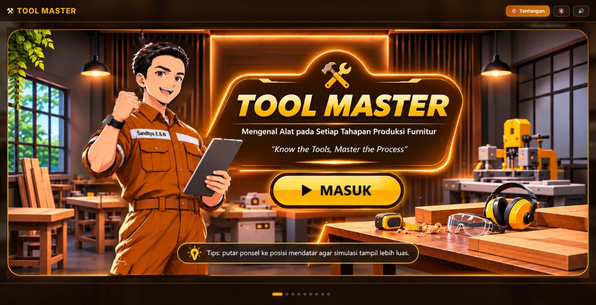
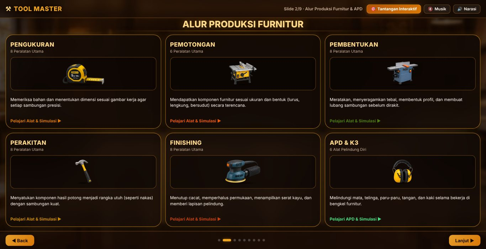
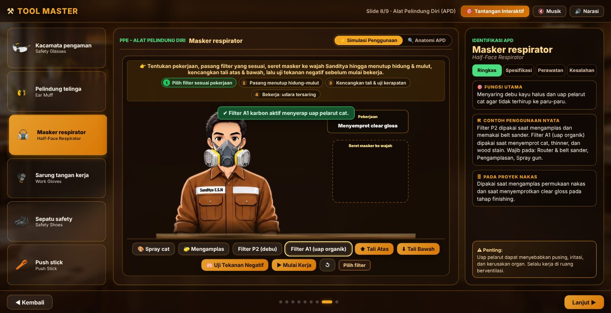
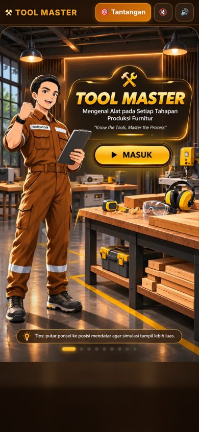

# 🔨 TOOL MASTER

**Mengenal Alat pada Setiap Tahapan Produksi Furnitur** · *Know the Tools, Master the Process*

Tool Master adalah media pembelajaran interaktif untuk siswa SMK (bidang furnitur/perkayuan). Siswa mengenal alat yang dipakai di setiap tahapan produksi, mempelajari bagian-bagiannya, lalu mencoba **simulasi cara penggunaannya**, termasuk alat pelindung diri (APD) dan K3.

👉 **Buka aplikasinya:** `https://NAMA-AKUN.github.io/tool-master/` *(ganti NAMA-AKUN dengan nama akun GitHub Anda)*

## Isi materi

| Tahapan | Jumlah | Contoh alat |
|---|---|---|
| Pengukuran | 8 alat | Meteran, mistar siku, jangka sorong, moisture meter |
| Pemotongan | 6 alat | Table saw, circular saw, jigsaw, band saw, mitre saw |
| Pembentukan | 8 alat | Jointer, planer, router, bor duduk, mesin bubut |
| Perakitan | 8 alat | Bor listrik, klem F, klem batang, palu karet, paku tembak |
| Finishing | 8 alat | Kape & dempul, belt sander, orbital sander, spray gun |
| APD & K3 | 6 alat | Kacamata, earmuff, masker respirator, sarung tangan, sepatu safety, push stick |

Setiap alat dilengkapi:
- **Anatomi**: nama dan fungsi tiap bagian alat.
- **Simulasi penggunaan**: siswa benar-benar mengoperasikan alat dan mendapat umpan balik bila caranya salah.
- **Keterangan**: ringkasan, spesifikasi, perawatan, dan kesalahan yang sering terjadi.
- **Tantangan interaktif** untuk menguji pemahaman.

## Cara memakai

- **Laptop/komputer:** buka tautan di atas dengan Chrome, Edge, atau Firefox. Tekan **F11** untuk layar penuh.
- **HP:** buka tautan di atas. Putar HP ke posisi mendatar agar simulasi tampil lebih luas.
- **Pasang seperti aplikasi:** di Chrome HP, pilih menu ⋮ → **Tambahkan ke layar utama** / **Instal aplikasi**. Setelah dibuka sekali, aplikasi tetap bisa dipakai tanpa internet.
- **Tanpa internet sama sekali:** unduh file `index.html`, lalu buka langsung di browser.

Musik latar menyala otomatis bila browser mengizinkan. Bila tidak, musik mulai pada sentuhan atau klik pertama, dan bisa dimatikan lewat tombol 🎵 di kanan atas.

## Isi repositori

| File | Keterangan |
|---|---|
| `index.html` | Seluruh aplikasi (gambar, simulasi, dan musik sudah ada di dalamnya) |
| `manifest.webmanifest`, `sw.js`, `icons/`, `favicon.png` | Agar bisa dipasang ke layar utama dan dibuka tanpa internet |
| `screenshots/` | Gambar untuk halaman ini |
| `.nojekyll` | Agar GitHub Pages menampilkan file apa adanya |

## Pembuat

Dikembangkan oleh **[nama pembuat / sekolah]** sebagai media pembelajaran produksi furnitur.
